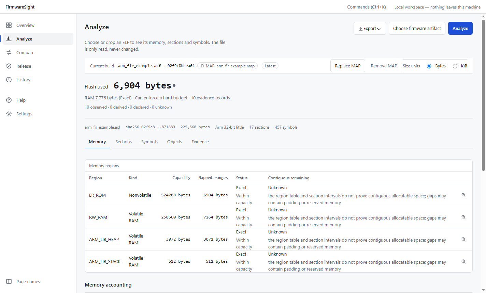
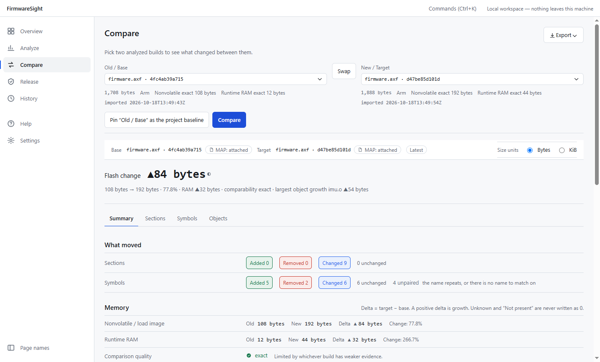

<div align="center">

# FirmwareSight

**A local-first release workbench for embedded firmware. Know exactly what ships.**

[](https://github.com/2023violet/FirmwareSight/actions/workflows/p0-check.yml)
[](https://github.com/2023violet/FirmwareSight/releases/latest)
[](LICENSE)


[简体中文](README.md) · **English**

</div>



FirmwareSight reads a firmware build (ELF / AXF / OUT and its linker MAP) and turns it into figures you can check: memory usage, build-to-build differences, and a release verdict. It comes as a desktop app and a command-line tool, `fwsight`. Everything runs on your machine; nothing is uploaded and nothing goes over the network.

## Contents

- [Features](#features)
- [Supported toolchains](#supported-toolchains)
- [Installation](#installation)
- [Quick start](#quick-start)
- [Principles](#principles)
- [Building from source](#building-from-source)
- [Documentation](#documentation)
- [Contributing](#contributing)
- [License](#license)

## Features

| Capability | What it does |
|---|---|
| **Analyze** | Parses ELF32 / ELF64 in either byte order. With the MAP it reports Flash and RAM usage, region capacities, sections, symbols, and usage per object file and library |
| **Compare** | A deterministic diff of two builds that explains each memory change and states how comparable the builds are (exact / partial / unknown) |
| **Release Gate** | Evaluates your project policy (`firmwaresight.toml`) — budgets, version, Git state and more — into one of PASS / REVIEW / BLOCK / UNKNOWN / N/A |
| **Release Bundle** | Writes a self-verifying evidence package (SHA-256 manifest, Gate results, analysis data, reports), with a pinned baseline and stored history |
| **Reports** | HTML, SVG / PNG summaries, Markdown for pull requests, and JSON. Output is deterministic: the same input gives the same bytes |

## Supported toolchains

| Input | Status |
|---|---|
| GCC / Clang + GNU ld: ELF and `.map` | ✅ Supported and verified |
| Keil MDK / Arm Compiler (armlink): `.axf` and `.map` | ✅ Supported: memory regions, MAP-backed accounting, object and library attribution, Compare. Checked against armlink's own totals on one synthetic sample and two real µVision projects ([evidence](evidence/D4-REAL/README.md)). Link with `--map --load_addr_map_info`, which is the µVision default |
| IAR Embedded Workbench for Arm (ILINK): `.out` and `.map` | ✅ Supported: memory regions (from the linker configuration's `place in` ranges), MAP-backed accounting, object and library attribution, Compare. Checked against IAR's own totals on real builds from nine open-source projects (ILINK 7.50–9.20): Flash matches on all of them ([evidence](evidence/D4-IAR/README.md)) |
| `.bin` / Intel HEX | Can be attached as release byte evidence; contents are not analyzed |

See [format support](04_TECH/03_FORMAT_SUPPORT.md) and [toolchain interoperability](04_TECH/39_ELF_TOOLCHAIN_INTEROPERABILITY.md).

## Installation

Download the files for your platform from [Releases](https://github.com/2023violet/FirmwareSight/releases/latest):

| Platform | Desktop app | Command line |
|---|---|---|
| Windows x64 | `FirmwareSight-<version>-windows-x86_64-nsis.exe` | `…-windows-x86_64-cli-fwsight.zip` |
| Linux x64 | `FirmwareSight-<version>-linux-x86_64-deb.deb` | `…-linux-x86_64-cli-fwsight.tar.gz` |
| macOS (Apple silicon) | `FirmwareSight-<version>-darwin-arm64-dmg.dmg` | `…-darwin-arm64-cli-fwsight.tar.gz` |

**Verify the download.** Every file carries a build-provenance attestation (Sigstore) signed by this repository's CI, which shows the workflow and commit that built it:

```bash
gh attestation verify FirmwareSight-0.7.0-windows-x86_64-nsis.exe --repo 2023violet/FirmwareSight
```

> [!NOTE]
> The installers have no Windows Authenticode signature and are not notarized by Apple, so SmartScreen or Gatekeeper will warn on first launch. Verify the file with the command above or against `SHA256SUMS.txt`, or [build from source](#building-from-source).

## Quick start

### Desktop app

1. Open **Analyze**, choose or drop a firmware file (`.elf` / `.axf`), then add its linker MAP.
2. Read the Flash and RAM usage, the headroom in each memory region, and the object files and libraries that use the most.
3. Analyze a newer build and open **Compare** to see where the change came from. Use **Release** to run the Gate against your policy and write a Release Bundle.



### Command line

```bash
# Analyze a build with its MAP and list usage per object file and library
fwsight analyze build/firmware.elf --map build/firmware.map --objects

# Compare two builds and write a Markdown report for a pull request
fwsight diff old.elf new.elf --old-map old.map --new-map new.map --markdown diff.md

# Evaluate the release Gate against the policy in the --project directory (firmwaresight.toml)
fwsight gate --project . --artifact build/firmware.elf --map build/firmware.map

# Once the Gate passes, write a self-verifying Release Bundle
fwsight release prepare --project . --artifact build/firmware.elf --map build/firmware.map --out dist/release
```

Each command accepts `--json` and then prints one machine-readable document. The Gate's exit code is meant for CI: `0` PASS, `4` REVIEW, `5` BLOCK. All options and exit codes are in the [CLI specification](04_TECH/07_CLI_SPEC.md).

A minimal project policy:

```toml
schema_version = 1

[project]
name = "brake-node"

[artifacts]
required = ["elf", "map"]

[memory]
flash_budget = 524288   # bytes
ram_budget = 131072

[diff]
flash_growth_review_bytes = 2048   # growth over the baseline beyond this gives REVIEW
```

## Principles

- **Local first.** No network access, no telemetry, no auto-update. History is kept in a local SQLite database.
- **Evidence classes.** Every figure says where it came from: Observed (read directly), Derived (computed from observed values), Declared (stated by the project) or Unknown. Missing evidence is shown as Unknown — never as zero, and never as proof.
- **A Gate is not a certification.** PASS means the build meets your project's own policy; it is not a safety certification or a licence to ship.
- **Deterministic output.** Reports and JSON carry no incidental timestamps, so the same input gives the same bytes on any machine. That makes them auditable and easy to regression-test.

## Building from source

Requirements: Rust `1.98.1` (pinned in `rust-toolchain.toml`), Node.js with Corepack (pnpm), Python 3, and on Linux the system packages Tauri needs.

```bash
git clone https://github.com/2023violet/FirmwareSight.git
cd FirmwareSight

# The command-line tool only
cargo build --release --bin fwsight

# The full local gate: Rust fmt / clippy / tests, frontend checks and tests, generated-output drift, cargo-deny
python scripts/check.py
```

Run one group with `python scripts/check.py --only <rust|frontend|drift|deny|core-smoke|package>`. CI runs the same checks on Windows, Linux and macOS; see the [CI/CD baseline](05_ENGINEERING/06_CI_CD_BASELINE.md).

### Repository layout

| Path | Contents |
|---|---|
| `crates/` | The headless Rust core and the artifact, storage, project and report crates |
| `apps/cli/` | The `fwsight` command-line tool |
| `apps/desktop/` | Tauri 2 shell (`src-tauri/`) and React UI (`ui/`) |
| `fixtures/`, `golden/`, `schemas/` | Test inputs, deterministic reference outputs, public data contracts |
| `01_PRODUCT/` … `09_ADR/` | Product, design, technical and engineering specifications, and architecture decisions |

## Documentation

| Topic | Where |
|---|---|
| Document index | [INDEX.md](INDEX.md) |
| Architecture decision records | [09_ADR/](09_ADR/) |
| Design system | [DESIGN.md](DESIGN.md) |
| Changes by version | [CHANGELOG.md](CHANGELOG.md), [Releases](https://github.com/2023violet/FirmwareSight/releases) |
| Current state, for contributors | [.ai/NOW.md](.ai/NOW.md) |

## Contributing

Issues and pull requests are welcome; see [CONTRIBUTING.md](CONTRIBUTING.md). Real build samples from more toolchains are especially welcome (the ELF and its `.map`, ideally with the project files, and free of proprietary code): they widen what is verified.

Please report security issues privately as described in [SECURITY.md](SECURITY.md), not as public issues.

## License

FirmwareSight is licensed under the [Apache License 2.0](LICENSE); see also [NOTICE](NOTICE). The release binaries include third-party components under their own licences, listed in [THIRD_PARTY_LICENSES.md](THIRD_PARTY_LICENSES.md).
