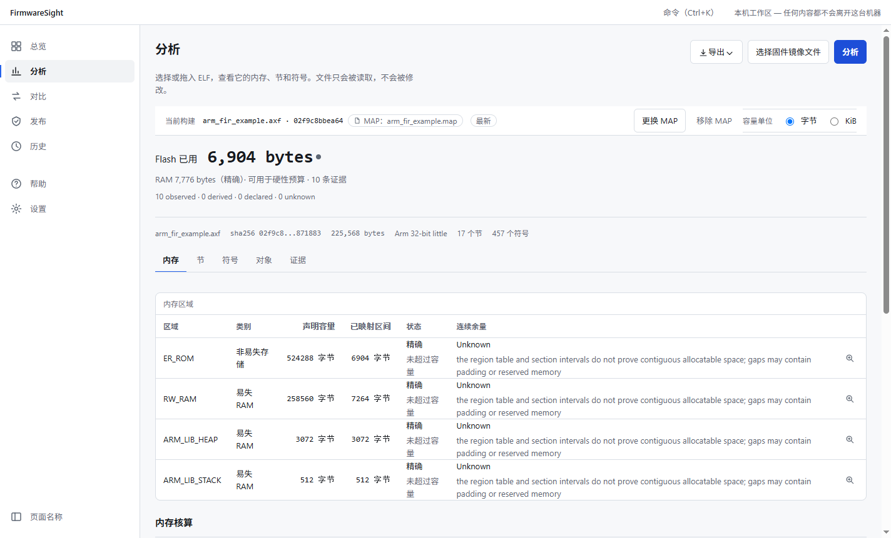
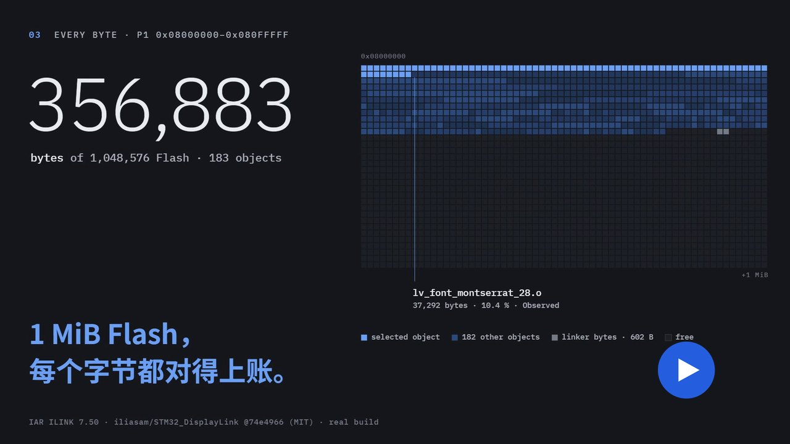
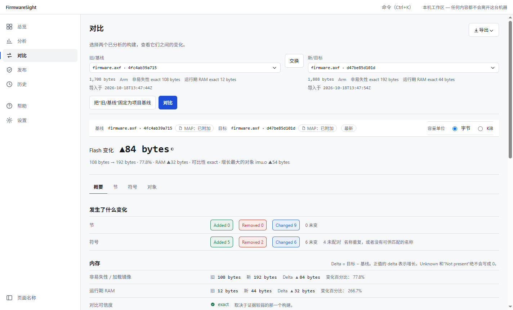

<div align="center">

# FirmwareSight

**面向嵌入式固件的本地发布工作台：说清楚每一次发布里到底有什么。**

[](https://github.com/2023violet/FirmwareSight/actions/workflows/p0-check.yml)
[](https://github.com/2023violet/FirmwareSight/releases/latest)
[](LICENSE)


**简体中文** · [English](README.en.md)

</div>



<p align="center"><a href="https://github.com/2023violet/FirmwareSight/releases/download/v0.8.0/FirmwareSight-0.8.0-launch-film.mp4"></a><br><sub>▶ <a href="https://github.com/2023violet/FirmwareSight/releases/download/v0.8.0/FirmwareSight-0.8.0-launch-film.mp4">观看 30 秒发布片</a>（MP4，8.6 MB，有声）· 配乐与字体致谢见 <a href="https://github.com/2023violet/FirmwareSight/releases/tag/v0.8.0">v0.8.0 发布说明</a></sub></p>

FirmwareSight 读取固件构建产物（ELF / AXF / OUT 及其链接器 MAP），给出可核对的内存占用、构建差异和发布结论。它提供桌面应用和命令行工具 `fwsight`，全部计算在本机完成，不联网，不上传任何文件。

## 目录

- [功能](#功能)
- [支持的工具链](#支持的工具链)
- [安装](#安装)
- [快速开始](#快速开始)
- [设计原则](#设计原则)
- [从源码构建](#从源码构建)
- [文档](#文档)
- [参与贡献](#参与贡献)
- [许可证](#许可证)

## 功能

| 能力 | 说明 |
|---|---|
| **分析** | 解析 ELF32 / ELF64（大小端），结合 MAP 给出 Flash / RAM 占用、内存区域容量、节、符号，以及按目标文件和库归属的占用 |
| **对比** | 对两个构建做确定性差异分析，逐项解释内存变化，并标注可比性（exact / partial / unknown） |
| **发布门禁** | 按项目策略 `firmwaresight.toml` 评估预算、版本、Git 状态等规则，结论为 PASS / REVIEW / BLOCK / UNKNOWN / N/A 五态之一 |
| **发布包** | 生成可独立校验的发布证据包（SHA-256 清单、门禁结果、分析数据、报告），可固定基线并留存历史 |
| **报告** | 导出 HTML、SVG / PNG 摘要、Markdown（适合贴进 PR）和 JSON；输出确定，同一输入得到相同字节 |

## 支持的工具链

| 输入 | 状态 |
|---|---|
| GCC / Clang + GNU ld：ELF 与 `.map` | ✅ 支持，已验证 |
| Keil MDK / Arm Compiler（armlink）：`.axf` 与 `.map` | ✅ 支持：内存区域、基于 MAP 的核算、目标文件与库归属、对比。已在 1 个合成样本和 2 个真实 µVision 工程上与 armlink 自身统计核对一致（[证据](evidence/D4-REAL/README.md)）。链接时需要 `--map --load_addr_map_info`，这是 µVision 的默认设置 |
| IAR Embedded Workbench for Arm（ILINK）：`.out` 与 `.map` | ✅ 支持：内存区域（取自链接配置的 `place in` 范围）、基于 MAP 的核算、目标文件与库归属、对比。已在 9 个开源项目的真实构建（ILINK 7.50–9.20）上与 IAR 自身统计核对：Flash 全部一致（[证据](evidence/D4-IAR/README.md)） |
| `.bin` / Intel HEX | 可作为发布字节证据附加，不解析其内容 |

详见 [格式支持](04_TECH/03_FORMAT_SUPPORT.md) 与 [工具链互操作性](04_TECH/39_ELF_TOOLCHAIN_INTEROPERABILITY.md)。

## 安装

从 [Releases](https://github.com/2023violet/FirmwareSight/releases/latest) 下载对应平台的文件：

| 平台 | 桌面应用 | 命令行 |
|---|---|---|
| Windows x64 | `FirmwareSight-<版本>-windows-x86_64-nsis.exe` | `…-windows-x86_64-cli-fwsight.zip` |
| Linux x64 | `FirmwareSight-<版本>-linux-x86_64-deb.deb` | `…-linux-x86_64-cli-fwsight.tar.gz` |
| macOS（Apple 芯片） | `FirmwareSight-<版本>-darwin-arm64-dmg.dmg` | `…-darwin-arm64-cli-fwsight.tar.gz` |

**校验下载。** 每个文件都附带由本仓库 CI 签发的构建来源证明（Sigstore），可以确认文件出自哪个工作流、哪个提交：

```bash
gh attestation verify FirmwareSight-0.8.0-windows-x86_64-nsis.exe --repo 2023violet/FirmwareSight
```

> [!NOTE]
> 安装包没有 Windows Authenticode 签名，也没有经过 Apple 公证，所以首次运行时 SmartScreen 或 Gatekeeper 会提示风险。请先用上面的命令或 `SHA256SUMS.txt` 校验文件，也可以[从源码构建](#从源码构建)。

## 快速开始

### 桌面应用

1. 打开 **分析**，选择或拖入固件文件（`.elf` / `.axf`），再添加它的链接器 MAP。
2. 读取 Flash / RAM 占用、各内存区域余量，以及占用最多的目标文件和库。
3. 再分析一个新构建，在 **对比** 中查看变化来源；在 **发布** 中按项目策略运行门禁，并生成发布包。



### 命令行

```bash
# 分析一个构建（附带 MAP），列出各目标文件和库的占用
fwsight analyze build/firmware.elf --map build/firmware.map --objects

# 对比两个构建，并生成适合贴进 PR 的 Markdown 报告
fwsight diff old.elf new.elf --old-map old.map --new-map new.map --markdown diff.md

# 按项目策略评估发布门禁（策略文件 firmwaresight.toml 放在 --project 目录）
fwsight gate --project . --artifact build/firmware.elf --map build/firmware.map

# 门禁通过后，生成可独立校验的发布包
fwsight release prepare --project . --artifact build/firmware.elf --map build/firmware.map --out dist/release
```

各命令都支持 `--json`，输出一个机器可读文档。门禁的退出码可以直接用于 CI：`0` 为 PASS，`4` 为 REVIEW，`5` 为 BLOCK。完整参数与退出码见 [CLI 规格](04_TECH/07_CLI_SPEC.md)。

一个最小的项目策略：

```toml
schema_version = 1

[project]
name = "brake-node"

[artifacts]
required = ["elf", "map"]

[memory]
flash_budget = 524288   # 字节
ram_budget = 131072

[diff]
flash_growth_review_bytes = 2048   # 相对基线增长超过该值时，结论为 REVIEW
```

## 设计原则

- **本地优先。** 不联网，无遥测，无自动更新。历史数据保存在本机 SQLite 中。
- **证据分级。** 每个数字都标明来源：Observed（直接读到）、Derived（由读到的值推算）、Declared（项目声明）或 Unknown（无法确定）。证据不足时明确显示 Unknown，绝不写成 0，也不当作已证实。
- **门禁不是认证。** PASS 只表示满足项目自己的策略，不代表安全认证或发布许可。
- **确定性输出。** 报告和 JSON 不含无关的时间戳；同一输入在任何机器上得到相同字节，便于审计与回归测试。

## 从源码构建

环境要求：Rust `1.98.1`（由 `rust-toolchain.toml` 固定）、Node.js 与 Corepack（pnpm）、Python 3；Linux 还需要 Tauri 依赖的系统包。

```bash
git clone https://github.com/2023violet/FirmwareSight.git
cd FirmwareSight

# 只构建命令行工具
cargo build --release --bin fwsight

# 完整本地检查：Rust fmt / clippy / test、前端检查与测试、生成物漂移、cargo-deny
python scripts/check.py
```

用 `python scripts/check.py --only <rust|frontend|drift|deny|core-smoke|package>` 可以只运行其中一组。CI 在 Windows、Linux、macOS 上运行同样的检查，说明见 [CI/CD 基线](05_ENGINEERING/06_CI_CD_BASELINE.md)。

### 仓库结构

| 路径 | 内容 |
|---|---|
| `crates/` | Rust 核心库（无界面）以及 artifact、storage、project、report 等库 |
| `apps/cli/` | 命令行工具 `fwsight` |
| `apps/desktop/` | Tauri 2 桌面外壳（`src-tauri/`）与 React 界面（`ui/`） |
| `fixtures/`、`golden/`、`schemas/` | 测试输入、确定性参考输出、公开数据契约 |
| `01_PRODUCT/` … `09_ADR/` | 产品、设计、技术、工程规格与架构决策记录 |

## 文档

| 主题 | 位置 |
|---|---|
| 文档总索引 | [INDEX.md](INDEX.md) |
| 架构决策记录（ADR） | [09_ADR/](09_ADR/) |
| 设计规范 | [DESIGN.md](DESIGN.md) |
| 版本变更 | [CHANGELOG.md](CHANGELOG.md)、[Releases](https://github.com/2023violet/FirmwareSight/releases) |
| 当前状态（面向贡献者） | [.ai/NOW.md](.ai/NOW.md) |

## 参与贡献

欢迎提交问题和 Pull Request，流程与要求见 [CONTRIBUTING.md](CONTRIBUTING.md)。特别欢迎提供更多工具链的真实构建样本（ELF 与 `.map`，最好附带工程文件，且不含专有代码），用于扩大验证范围。

发现安全问题时，请按 [SECURITY.md](SECURITY.md) 私下报告，不要公开提 issue。

## 许可证

FirmwareSight 以 [Apache License 2.0](LICENSE) 发布，另见 [NOTICE](NOTICE)。发布的二进制文件包含第三方组件，其许可证列在 [THIRD_PARTY_LICENSES.md](THIRD_PARTY_LICENSES.md) 中。
